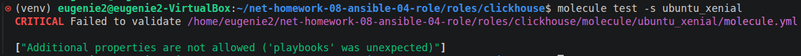
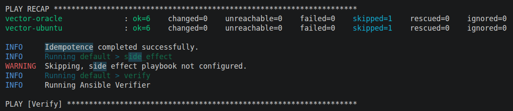
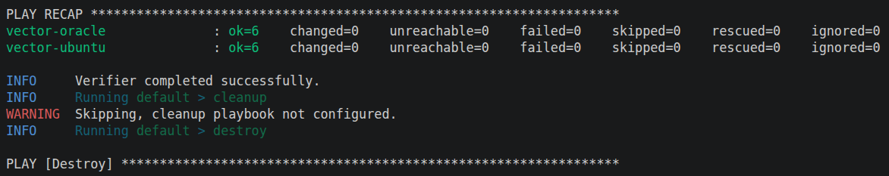
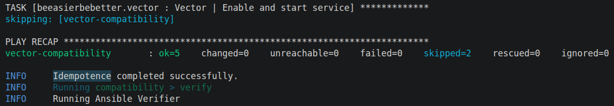
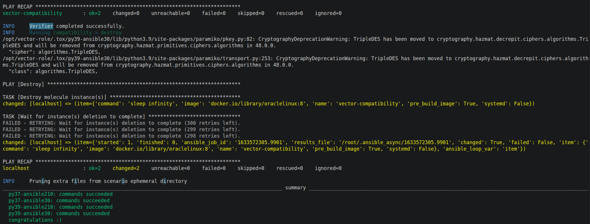

# Домашнее задание к занятию 5 «Тестирование roles» `Котуков Евгений`

## Molecule

Тег: [1.1.0](https://github.com/beeasierbebetter/vector-role/tree/1.1.0)

Выполнил пробный запуск сценария `ubuntu_xenial` роли ClickHouse, но он завершился с ошибкой валидации конфига, \
по заданию это допускается

Для Vector создал сценарий `molecule/default` с драйвером Docker, тестирование проходит на Ubuntu 24.04 и Oracle Linux 8

Для прогона на Oracle Linux дополнил роль установкой RPM-пакета

Команда для запуска: `molecule test -s default`

Проверены:

- идемпотентность роли
- наличие файла конфигурации
- валидность конфига командой `vector validate`
- запуск службы Vector
- включение автозапуска службы

Проверка идемпотентности прошла успешно на обоих дистрибутивах:

Все проверки из `verify.yml` тоже прошли без проблем:

## Tox

Тег: [1.2.0](https://github.com/beeasierbebetter/vector-role/tree/1.2.0)

Добавлены файлы `tox.ini` и `tox-requirements.txt`

Создал облегчённый сценарий `molecule/compatibility` с драйвером Podman и одним контейнером Oracle Linux 8

Сценарий проверяет установку Vector, валидность конфига и идемпотентность, \
параметр `vector_manage_service: false` отключает в этом сценарии управление службой, а проверки службы выполняются docker-сценарием `default`

Отдельный запуск Podman-сценария прошел успешно:

Тестирование Tox выполнялось внутри контейнера `aragast/netology:latest` командой `tox`

| Python | Ansible | Результат |
|---|---|---|
| 3.7 | 2.10 | commands succeeded |
| 3.7 | 3.0 | commands succeeded |
| 3.9 | 2.10 | commands succeeded |
| 3.9 | 3.0 | commands succeeded |

Все четыре окружения успешно завершились:

